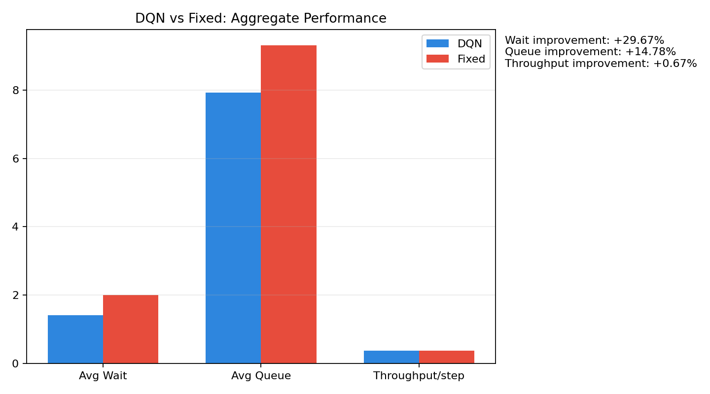
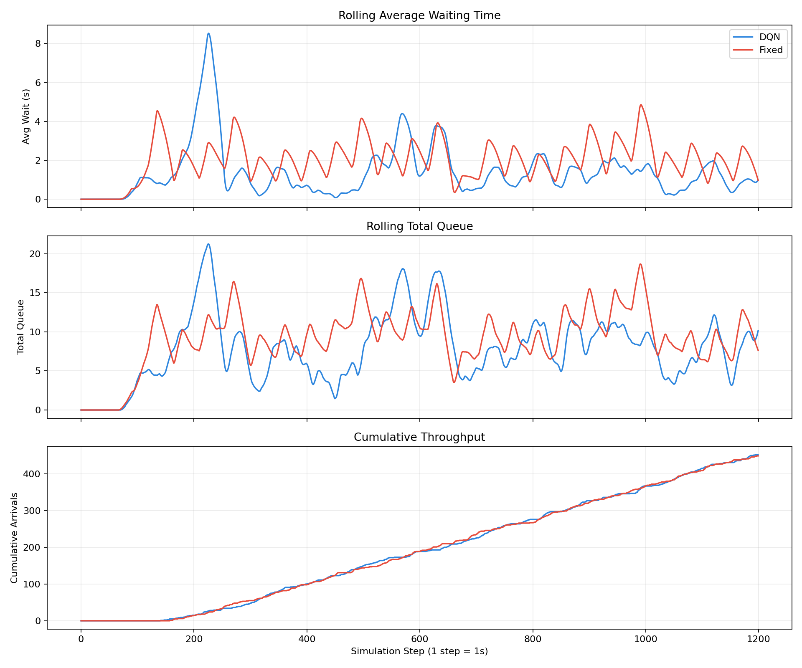
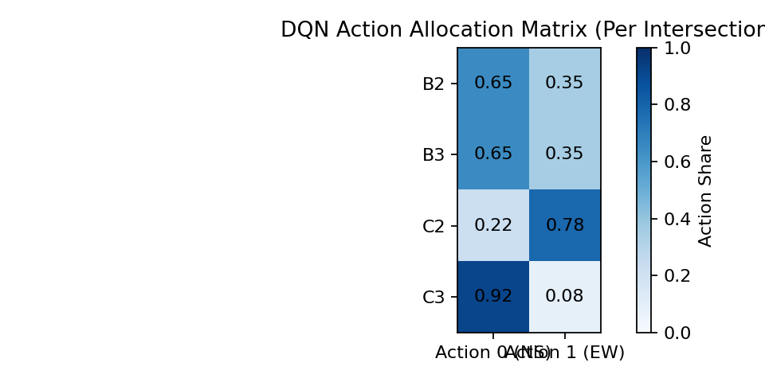

# City-Wide Traffic Signal Control with Deep Reinforcement Learning

Decentralized multi-agent DQN traffic signal control on a 4x4 intersection grid, simulated in [SUMO](https://sumo.dlr.de/). Each intersection is controlled by its own agent, and the learned policy is compared against a fixed-time baseline in synchronized simulations.

## Results





Raw per-step data: [`research_outputs/step_metrics.csv`](research_outputs/step_metrics.csv), summary: [`research_outputs/summary.json`](research_outputs/summary.json).

## 1. Problem Statement

Urban traffic congestion is a persistent challenge in modern cities, causing increased travel time, fuel consumption, emissions, and delays in emergency response. Conventional fixed-time traffic signals use static phase schedules that do not adapt to real-time demand, which often leads to unnecessary queuing and idle time at intersections.

This project develops an adaptive traffic signal control framework using Deep Reinforcement Learning in a city-scale SUMO network. The system uses a decentralized multi-agent setup in which each controlled intersection is managed by an independent Deep Q-Network (DQN) agent. Each agent observes local traffic conditions and selects a signal phase family at fixed decision intervals to reduce congestion and delay.

The core objective is to learn robust signal-control policies directly from interaction with simulation, rather than manually designing timing plans for every traffic pattern. The current implementation includes decentralized multi-agent DQN training and synchronized comparison against a fixed-time baseline.

## 2. Algorithm

### 2.1 Reinforcement Learning Framework (DQN)

Each intersection is controlled by one DQN agent.

**State:** `s_t = [g_t, q_in_1..q_in_4, q_out_1..q_out_4]`

1. `g_t ∈ {0,1}` is the current phase group (NS or EW family).
2. `q_in_i` are normalized halting counts on incoming lanes.
3. `q_out_i` are normalized halting counts on outgoing lanes.

**Actions:** `a_t ∈ {0,1}`

1. `0`: North-South green family (SUMO phase 0).
2. `1`: East-West green family (SUMO phase 2).

**Reward:** `R_t = -(1.0·Q_in + 0.5·|Q_in − Q_out| + 0.2·W_avg)`

1. `Q_in`: total incoming halted queue.
2. `Q_out`: total outgoing halted queue.
3. `W_avg`: average waiting time at the intersection.

**Target (Double-DQN style):** `y_t = r_t + γ · Q_θ⁻(s_{t+1}, argmax_a Q_θ(s_{t+1}, a))`

**Loss:** Huber(`Q_θ(s_t, a_t)`, `y_t`)

Core settings:

1. Experience replay buffer (capacity 10,000).
2. Epsilon-greedy exploration with decay.
3. Online and target networks.
4. Adam optimizer.
5. Periodic target synchronization (every 200 training steps).

### 2.2 Training Procedure

1. Initialize SUMO environment and one DQN agent per controlled intersection.
2. Initialize replay memory and neural networks.
3. For each episode:
   1. Reset simulation.
   2. At each decision interval, collect local state and choose action via epsilon-greedy policy.
   3. Apply selected phase family.
   4. Accumulate interval reward and observe next state.
   5. Store transition in replay memory.
   6. Sample mini-batches and update online network after warmup.
   7. Periodically sync target network.
4. Save per-agent checkpoints each episode.
5. Evaluate learned policy in synchronized DQN vs fixed-time simulations.

### 2.3 Multi-Agent Design

1. One decentralized DQN agent per intersection.
2. No explicit inter-agent communication in the current implementation.
3. Coordination emerges implicitly through shared traffic flow dynamics.
4. This design improves scalability and practical deployability compared with communication-heavy schemes.

## 5. Results

### 5.1 Evaluation Setup

The trained decentralized DQN agents were evaluated against a fixed-time baseline using synchronized parallel SUMO simulations on the 4x4 grid network. Both controllers were tested under identical traffic demand and simulation conditions.

### 5.2 Comparative Performance

Primary comparison run (1200-step evaluation):

| Metric | DQN | Fixed-Time | Improvement |
|---|---:|---:|---:|
| Avg Waiting Time (s) | 1.4075 | 2.0013 | 29.67% reduction |
| Avg Queue Length (veh) | 7.9333 | 9.3092 | 14.78% reduction |
| Throughput (veh/step) | 0.3767 | 0.3742 | 0.67% increase |

Additional longer-horizon check (1800 steps) showed consistent delay/queue gains:

1. Waiting time reduction: 22.77%
2. Queue reduction: 11.54%
3. Throughput change: -1.53%

### 5.3 Interpretation

The results confirm that decentralized DQN control substantially improves traffic efficiency over static fixed-time timing. The largest gains are seen in delay and queue metrics, which are the primary optimization targets. Throughput remains comparable across controllers, indicating that delay reduction is achieved without sacrificing network discharge capacity.

## Running it

Requires SUMO (set `SUMO_HOME`) and Python with `traci`, `sumolib`, `numpy`, and TensorFlow/Keras.

```bash
python train_multi_agent.py          # train one DQN agent per intersection
python compare_multi_agent.py        # synchronized DQN vs fixed-time run
python generate_dqn_research_graphs.py   # writes research_outputs/
```

Network files live in [`sumo_files/4x4/`](sumo_files/4x4/). See [`README_SUMO.md`](README_SUMO.md) for SUMO setup and the original single-intersection Q-learning version.
